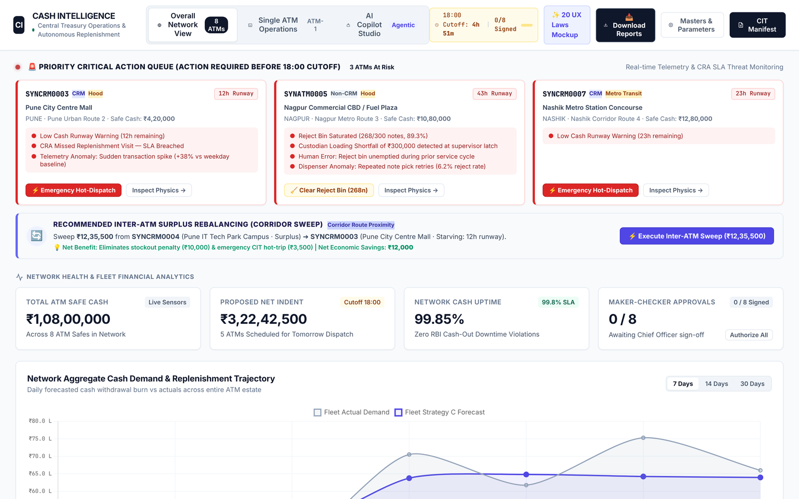
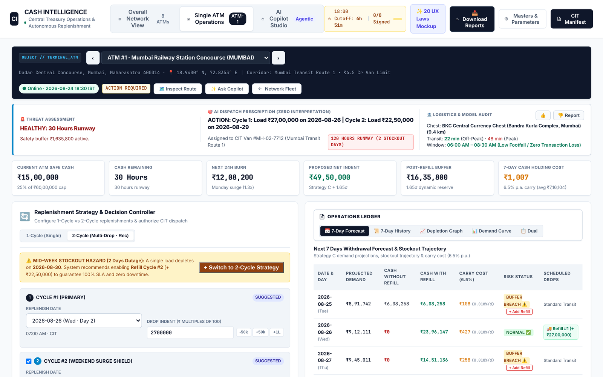
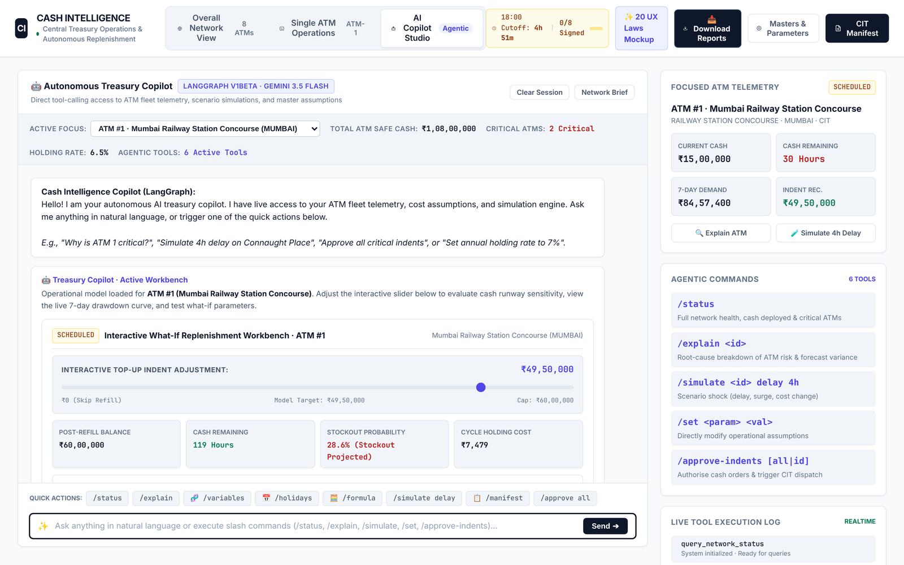

# ATM Cash Forecasting & Replenishment

Forecasts daily cash withdrawals for a fleet of ATMs in India and turns those forecasts into replenishment decisions: how much cash to load, when, and at what risk. An operator reviews, adjusts and approves each recommendation in a web portal.

> **Data note:** all ATM data in this project is **synthetic**: 100 ATMs over 754 days (Sep 2024 to Sep 2026), produced as 15-minute cash snapshots. Calendar inputs use real public sources (RBI regional holiday calendars, Open-Meteo weather). Results below show the method works on realistic simulated data. They are not evidence of performance on a real bank's network.



## The problem

Banks have to load cash into ATMs before they run out. Load too little and the ATM goes empty: customers are turned away, and in India that can mean regulatory penalties. Load too much and idle cash sits in a machine earning nothing, plus every extra cash-van visit costs money. A good forecast only matters if it changes that loading decision, so this project follows the whole chain from raw machine data to an approved dispatch list.

```
15-min cash snapshots → daily demand → calendar / holiday / payday features
   → LightGBM forecasts (P50 / P80 / P95) → buffer & indent sizing (capacity-aware)
   → operator review (maker / checker) → cash-van dispatch manifest
```

## Results

All figures are WAPE (weighted absolute percentage error: total absolute error ÷ total demand; lower is better). Each test only uses data that would have been available at the time of the forecast.

| Evaluation | Model | Baseline | Result |
| --- | --- | --- | --- |
| 100-ATM network, 1-day-ahead, three 30-day rolling folds | Quantile LightGBM: **17.94%** | Same weekday last week: 29.16% | **~38% lower error** |
| 8-ATM Maharashtra pilot, 55 weekly rolling origins (3,080 daily predictions) | LightGBM: **18.59%** daily / **9.02%** weekly | Seasonal mean: 21.09% / 10.35% | Beats a strong seasonal benchmark |
| Feature test (Experiment 4) | History + calendar: **18.74%** / 9.37% | History only: 21.75% / 12.13% | Calendar features give the clearest gain. Weather adds little. |

What the experiments showed:
- **Calendar effects (paydays, regional holidays) matter more than weather.** Weather was also left out of the main evaluation, because historical weather isn't something you'd know in advance.
- **Recorded withdrawals understate demand when an ATM runs empty.** The project estimates the missing demand and tests that estimate by deliberately hiding known data and checking how well it gets reconstructed. It works when the missing hours are spread evenly and gets worse when peak hours are missing.
- **More features don't always help.** Controlled tests that add or remove one group of inputs at a time showed several inputs didn't earn their place.

## What's in the portal

The portal is in `live_portal_v2/`, served by a small Python backend.

| Area | What it does |
| --- | --- |
| **Fleet overview** | Cash held across the fleet, ATMs ranked by how soon they run out, critical alerts, suggestions to move cash between nearby ATMs |
| **Single-ATM operations** | 7-day forecast, cash running down day by day, 1-cycle vs 2-cycle refill plans, holding-cost calculation, note mix by denomination |
| **Explainability** | Every recommendation shows its inputs, assumptions and the formula behind the cash amount |
| **Maker / checker** | The system proposes a load, a reviewer adjusts it with a reason and approves it, then a dispatch manifest is built per route |
| **Masters & parameters** | Edit holding rates, capacity, servicing cycle and event multipliers; recommendations recalculate immediately |
| **AI copilot** | A LangGraph agent with tools for fleet status, explaining an ATM, what-if simulations, changing parameters and approvals. Slash commands still work without an API key. |

| Single-ATM view | AI copilot |
| --- | --- |
|  |  |

## Run it

```bash
python -m venv .venv && source .venv/bin/activate
pip install -r requirements.txt
python live_portal_v2/serve.py        # http://localhost:8089
```

The copilot uses Google Gemini if `GEMINI_API_KEY` is set in the environment or in a `.env` file. Without a key it falls back to slash commands (`/status`, `/explain`, `/simulate`, …).

Re-run the forecasting evaluation:

```bash
python simulated/maharashtra/run_rolling_origin.py   # rolling-origin backtest → simulated/maharashtra/output/
python replenishment_engine/run_simulation.py        # replenishment cost simulation
```

## Repository layout

| Path | Contents |
| --- | --- |
| `live_portal_v2/` | **Current portal**: UI, server, masters manager, LangGraph agent |
| `replenishment_engine/` | Reusable forecasting, missing-demand estimation, buffer sizing, cost model and backtesting |
| `simulated/maharashtra/` | 8-ATM pilot: rolling-origin evaluation, quantile forecasts, findings (`FINDINGS.md`) |
| `layman experiments/` | Feature tests, missing-demand reconstruction checks, charts |
| `data/` | Raw synthetic snapshots, processed daily demand, RBI holiday references, master data, frozen baseline (see `data/README.md`) |
| `live_portal/`, `UI_2/` | Earlier portal versions, kept for reference |
| `PROJECT_REVIEW.md` | Detailed write-up of methodology, results and limitations |

**Stack:** Python, pandas, NumPy, LightGBM, scikit-learn, LangGraph, Gemini, vanilla JS, Chart.js, Leaflet.

## Known limitations

These are documented in full in [`PROJECT_REVIEW.md`](PROJECT_REVIEW.md):
- The replenishment engine's train/test split can let information from after the forecast date leak into training, and its "last week" baseline is simplified. The engine's cost-saving figure (about 18%) should not be relied on until both are fixed and the comparison is rerun. The forecast WAPE results above come from separate, correctly split evaluations.
- Event multipliers in the portal ignore their date ranges.
- Maker/checker is a workflow demo. There's no authentication, approvals are held in memory, and the manifest "signature" is a hash, not a cryptographic signature.
- No automated test suite yet.

## Next steps

Fix the engine's train/test split and rerun the cost comparison, then calibrate how uncertainty is estimated across a whole week. After that, add authentication and permanent records of approvals, write tests that check cash amounts and capacity limits always hold, and run a pilot on real withdrawal and replenishment data.
